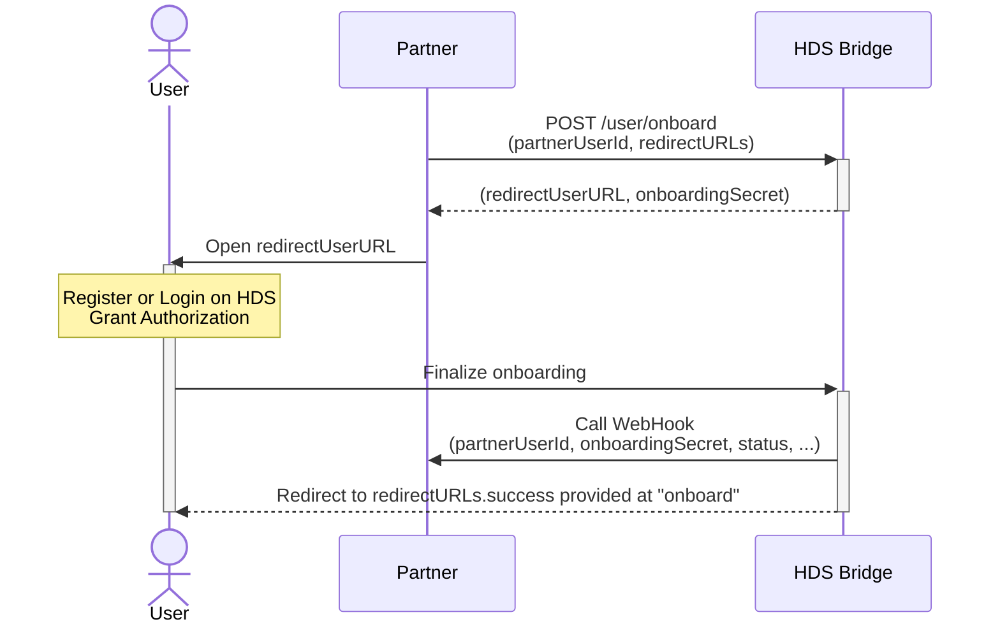

# lib-bridge-js

Library for building HDS partner bridges — machine-to-machine services that handle user onboarding and data synchronization between partner platforms and [Health Data Safe](https://github.com/healthdatasafe).

Each bridge is a standalone app that depends on this library. See [bridge-chartneo](https://github.com/healthdatasafe/bridge-chartneo) for a real-world example.

## What it provides

- Express server with clustering, CORS (origin allow-list in `server:corsOrigins`), JSON parsing, error handling
- Partner authentication middleware (`partnerAuthToken` header check)
- Partner user onboarding flow (initiate → HDS auth → finalize → webhook), mounted only when `partnerAuthToken` is configured
- Bridge account management (user credentials, sync status, error logging)
- `PluginBridge` base class for partner-specific logic
- Test utilities for consumer repos

## Public API

```typescript
import {
  PluginBridge,        // Base class — extend this for your bridge
  startCluster,        // Entry point with clustering
  createBridgeApp,     // Express app factory
  initBoiler,          // Config initialization (accepts consumer configDir)
  errors,              // Error helpers (assertFromPartner, badRequest, etc.)
  Router,              // express-promise-router
  initHDSModel,        // HDS data model init (re-exported from hds-lib)
  getHDSModel,         // HDS data model access (re-exported from hds-lib)
  ensureAppStreamsTree,// Provision a {appId}-app/ subtree on a user account (Plan 25 / Plan 45 §9)
  testServer           // Test helpers (init, apiTest, createOnboardedUser, etc.)
} from 'lib-bridge-js';
```

### App-stream subtree (`ensureAppStreamsTree`)

Bridges should publish their app-specific content (notes, messaging, …) under a stable `{appId}-app/` subtree per the Plan-25 convention. Use the helper rather than rolling your own `streams.create` boilerplate:

```typescript
import { ensureAppStreamsTree } from 'lib-bridge-js';

const { appStreamId, subStreamIds } = await ensureAppStreamsTree(hdsConnection, {
  appId: 'my-bridge',
  baseName: 'My Bridge App',
  parentId: 'my-bridge',                            // optional: child of an existing base
  subStreams: [
    { suffix: 'notes', name: 'Notes' },             // → my-bridge-app-notes
    { suffix: 'chat',  name: 'Chat',                // → my-bridge-app-chat
      clientData: { hdsCustomField: { /* … */ } }   // optional clientData per substream
    }
  ]
});
// Use appStreamId on the bridge access via appTemplates.ensureBridgeAccess({ clientData: { appStreamId } })
```

Idempotent (tolerates `item-already-exists`).

## Creating a bridge

### 1. Define your bridge class

```typescript
// src/index.ts
import { PluginBridge } from 'lib-bridge-js';
import type { Application } from 'express';

export default class MyBridge extends PluginBridge {
  override get key () { return 'my-bridge'; }

  override get potentialCreatedItemKeys () {
    return ['body-weight']; // HDS item keys this bridge creates
  }

  override async init (app: Application, bridgeConnectionGetter: () => unknown) {
    await super.init(app, bridgeConnectionGetter);
    // Load routes, initialize singletons
    app.use('/data/', myDataRoute);
  }

  override async newUserAssociated (partnerUserId: string, apiEndPoint: string) {
    // Called when a user completes onboarding
    return { status: 'ok' };
  }
}
```

### 2. Create the entry point

```typescript
// src/start.ts
import { startCluster } from 'lib-bridge-js';
import MyBridge from './index.ts';
startCluster(new MyBridge(), import.meta.dirname + '/../config');
```

### 3. package.json

```json
{
  "dependencies": {
    "lib-bridge-js": "git+https://github.com/healthdatasafe/lib-bridge-js.git"
  },
  "scripts": {
    "start": "node --experimental-strip-types src/start.ts",
    "setup:dev": "npm install && cd node_modules/lib-bridge-js && npm install"
  }
}
```

The bridge's only dependency is `lib-bridge-js` — all other packages (express, hds-lib, boiler, etc.) come transitively. `setup:dev` installs lib-bridge-js's devDependencies (mocha, supertest, etc.) for testing.

### 4. Configuration

Provide a `config/` directory with:
- `default-config.yml` — framework defaults + bridge-specific defaults (service config, permissions, etc.)
- `test-config.yml` — test overrides (unsafe token, localhost, disabled logs)
- `localConfig.yml` — minimal, just deployment secrets (`bridgeApiEndPoint`)

In production (Dokku), secrets come from environment variables — no mounted config files needed.

## Bridge API

### Availability

These partner routes (`/user/*`, `/account/errors`) exist only on a bridge whose config sets `partnerAuthToken`, i.e.
a bridge with a partner backend (chartneo). Without it they are not mounted and answer 404; bridges whose users connect
through CMC or OAuth (mira, tempdrop) do not need them.

### Authorization

All API calls require the `Authorization` header with the value set in `partnerAuthToken`.

### `POST /user/onboard`

Initiate user onboarding.

**@body**
- `partnerUserId`: {string}
- `redirectURLs`: {Object} — `success`, `cancel` URLs
- `clientData`: {Object} — key-value pairs sent back via webhook

**@returns** — either `authRequest` (new user) or `userExists` (already onboarded)

### Onboarding flow



Detailed flow: [doc/onboarding-flow-detail.md](./doc/onboarding-flow-detail.md)

### `GET /user/{partnerUserId}/status`

Returns user status, credentials, and sync status. 404 if not found.

### `POST /user/{partnerUserId}/status`

Change the `active` status of a user. Body: `{ "active": true|false }`.

### `GET /account/errors/`

Retrieve error log from the bridge account. Query params: `limit`, `fromTime`, `toTime`.

### Webhook

The partner webhook is called on onboarding success, cancel, or error. Configured via `partnerURLs.webhookOnboard` (url, method, headers).

Parameters sent: `type` (SUCCESS/CANCEL/ERROR), `partnerUserId`, `onboardingSecret`, `clientData` values, `pluginResultJSON` (on success).

## CMC relationships

For a bridge that collects data through CMC relationships (the person accepts an invite in the HDS app) instead of
the partner onboarding flow. Partner bridges are untouched.

**Enable** with config `cmc:enabled: true` (creates the `{main}-cmc` stream that holds the inbox cursor; `start()`
refuses without it). `service:apiEndpointHostPattern` must name the platform's domain (null refuses every accept) and
`service:patientAppBaseUrl` the HDS app. Other keys and their defaults are in `config/default-config.yml` § `cmc:`
(app code, invite expiry and features, inbox interval and lag, scope poll, reconciliation, lease TTL, webhooks).

**Start it from `PluginBridge.init`**, before the lib collects route patterns for telemetry (plugin init already runs
first):

```typescript
import { createCmcRelationships, type CmcRelationships } from 'lib-bridge-js';

override async init (app: Application, bridgeConnectionGetter: () => unknown) {
  await super.init(app, bridgeConnectionGetter);
  this.cmc = createCmcRelationships({
    appCode: 'hds-bridge-reader',                 // → :_cmc:apps:hds-bridge-reader
    hooks: {
      requestedPermissions: () => [{ streamId: 'hds-reader-inbox', level: 'read' }],
      onAccepted: async (rel, { replaced }) => { /* first sync, or new grant for the same person */ },
      onChange: async (rel, { reason, modifiedSince }) => { queue.add(rel.userKey, modifiedSince); },
      onScopeAnswer: async (rel, { answer, permissions }) => { /* ... */ },
      onRevoked: async (rel, reason) => { /* drop the person's queue and state */ } // required
    }
  });
  await this.cmc.start(app);
}
```

Then `cmc.createInvite({ expectedUsername })` → `{ inviteEventId, capabilityUrl, patientUrl }`; `cmc.get(userKey)` →
the relationship (`record`, `connection()` over the data grant, `scope.widen / replace / requestDataSet`, `status`,
`sendSystemAlert`); `ensureLive`, `firstConnectAllowed`, `reportAccessError` (after a `forbidden` /
`invalid-access-token` from a write), `revoke`. Storage is keyed per person (`userKey`, default the slug of the
verified username and host): the credential event of `{main}-users-{userKey}` with the record as
`clientData.hdsCmc`.

- **`onChange` must be short and idempotent**: enqueue and return. It runs under the relationship's lease, may be
  coalesced and called again (`reason: 'again'`), and long work belongs to the plugin's own queue.
- `onAccepted` that throws is retried by reconciliation; `onRevoked` that throws keeps the record live and is
  retried. A re-accept by the same person swaps the grant (`replaced: true`) and never calls `onRevoked`.
- The inbox, scope-answer and reconciliation loops run on the scheduler worker only.
- **Webhooks** (`cmc:webhooks:enabled` + a public `publicBaseUrl`, and a `webhookScopes` hook) mount
  `POST /cmc/hook/:hookId`. The core refuses private hosts, so **local development runs poll-only** (webhooks off):
  reconciliation polls every `cmc:reconcile:intervalS`.
- **Never an apiEndpoint in logs or telemetry**: the module logs user keys and relationship ids only, records
  telemetry through the closed sets `CMC_METHOD_IDS` / `CMC_ERROR_CODES`, and `connection()` is the only way to the
  grant. Keep it so in hooks.

### The standard conversation (`rel.conversation`)

A bridge that reads documents and proposes values (the HDS Reader, a third party's counterparty) talks to the person
through the standard conversation of the relationship, data-model 4.22.0 `documentation/CONVERSATION.md` (the wire
contract). `rel.conversation` is bound to one relationship: items go on her account through the data grant (her app
creates the two `conversation-items` children and grants `contribute` on `received`, `read` on `sent`), alerts on the
bridge account's collectors stream of that person. Every item and alert is checked first (hds-lib `cmcConversation`).

```typescript
const conv = rel.conversation;
await conv.postStatus(docId, 'reading', { attempt: 1 });
await conv.proposeValues(docId, [{ candidateId, printed, anchor, proposal, status: 'clear', extraction }]); // + 1 alert
await conv.ask({ about: docId, code: 'is-this-yours', context: { identity } });                         // + its alert
await conv.postStatus(docId, 'awaiting-answers', { attempt: 1, counts: { proposed, questions, keptAside, dropped } });

for (const alert of await conv.answerAlerts({ fromTime })) {   // her answers, delivered on the collectors stream
  const answer = await conv.answerOf(alert);                    // null unless on her sent child (R11)
  const state = await conv.read(alert.hds.about);               // confirmed / corrected / skipped / replaced ...
}
await conv.postStatus(docId, 'done', { attempt: 1 });
await conv.cleanupDocument(docId, 'done');                      // R10 on her account; 'not-mine' / 'unshared' too
await conv.deleteOwnAlerts(alertIds);                           // R10 on the bridge account
```

- **The bridge never writes a value**: her app writes what she confirmed (`answer.written` says which event).
- `proposeValues` is idempotent per `candidateId` (R5): an unanswered candidate is rewritten in place, an answered or
  written one is left alone; derive `candidateId` deterministically from the document, the record and the proposal.
- No value, name or date ever goes in an alert or a chat message (R6): the alerts carry kinds, ids, codes and counts.
- `conv.streams()` is null until she granted the children; the other calls then refuse with `no-conversation`.
- `bindConversation({ person, bridge, record })` gives the same object outside the CMC module.

## Storage

The bridge uses a dedicated HDS account for storage. Under the root stream (`service.bridgeAccountMainStreamId`, default "bridge"):
- `bridge-users` → `bridge-user-{partnerUserId}` — per-user credentials and auth requests
- `bridge-users-active` — tags active user credentials
- `bridge-errors` — onboarding error log
- `bridge-cmc` — CMC inbox cursor (only with `cmc:enabled`)

## Prerequisites

- Node.js >= 22.6.0
- npm >= 9.6.5

## Setup

```bash
npm run setup            # Install dependencies + HDS setup
npm run setup-dev-env    # Dev environment (test HDS account)
```

Edit `localConfig.yml` — see `config/sample-localConfig.yml` for reference.

## Development

```bash
npm test                 # Run tests (uses ./localConfig.yml when present)
npm test -- --grep=PLTX  # Run specific tests
config=/path/to/other.yml npm test   # Run tests against another config file
npm run test:coverage    # Coverage report
npm run lint             # Lint
```

The config file reaches the tests through the `config` environment key (`tests/setupConfig.ts`), not a
`--config` argument, which mocha would take for its own rc file. Without a provisioned
`bridgeApiEndPoint` (no `localConfig.yml`, or one still set to `OVERRIDE_ME`), the suites that need the
live bridge account skip and the rest run.

The CMC live suite (`tests/cmcLive.test.ts`) creates its own throwaway bridge and person accounts on the configured
platform, and runs only on a test platform (demo or a local core) when `CMC_LIVE=1` or a bridge account is configured:

```bash
CMC_LIVE=1 npm test -- --grep LCM
```

The test suite includes `SampleBridge` in `tests/sample-bridge/` — a minimal bridge that demonstrates how to use the library. It follows the same pattern as real bridges like bridge-chartneo.

## HTTPS for local development

`backloop.dev` is opt-in. Set `BACKLOOP=true` (as `npm run start:backloop` does) and the server
listens over HTTPS on `https://mira.backloop.dev:<port>`, a hostname that resolves to `127.0.0.1`.
Leave it unset and the server listens on plain HTTP on `127.0.0.1`, so nothing is required to run
this library.

Certificates come from the [`backloop.dev`](https://github.com/perki/backloop.dev-node) package,
installed directly from GitHub rather than npm. With no configuration it downloads a shared,
self-signed certificate; install it once per machine by following <https://backloop.dev/public/>.
Firefox will not accept it, because it ignores the system trust store. To use your own certificate
instead, point `BACKLOOP_DEV_CERT` and `BACKLOOP_DEV_KEY` at the PEM files.

If you are updating an existing checkout, delete the stale copy first. npm does not replace a
package that moved from the registry to a git URL: it leaves the old directory in place while
`npm ls` reports the new version.

```sh
rm -rf node_modules/backloop.dev && npm install
```

## License

[BSD-3-Clause](LICENSE)
